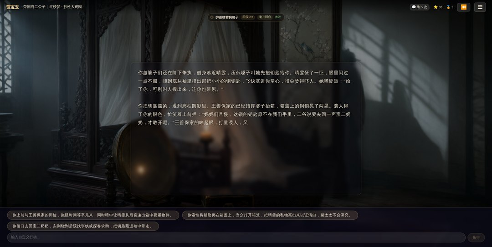
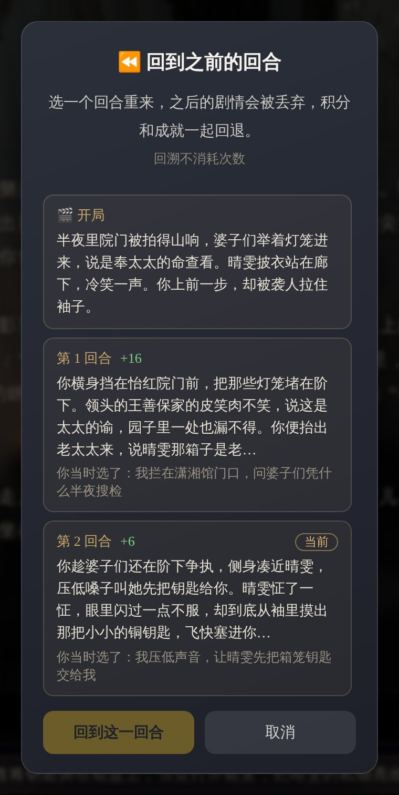
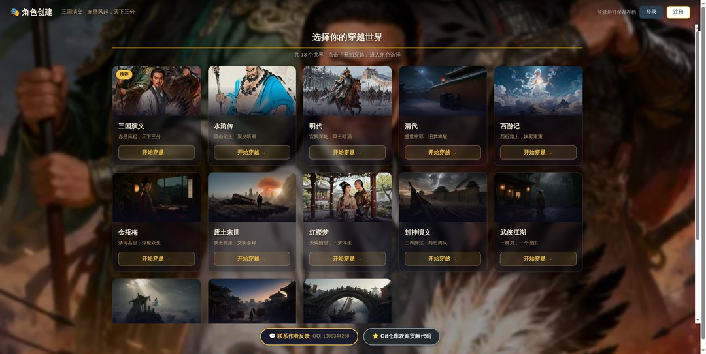

# 公众号文章 · 穿越模拟器

> `wechat-article.md` 是正文与配图位置；`wechat-article.html` 可直接粘进公众号编辑器并保留排版。
> 图片都在 `docs/wechat/`，公众号编辑器不吃 webp，这里已转成 jpg。

## 发布信息

- **标题**：我在《红楼梦》里连输八回合，它接着往下写
- **备选标题**
  1. 我在《红楼梦》里连输八回合，它接着往下写
  2. 抄检大观园那一夜，我什么都没做
  3. 十三个世界，每个角色一条命，没有存档大法
- **摘要（≤120 字）**：我故意在抄检大观园里连输八回合，然后按了"继续"。它没有让我重开，而是给我生成了第二幕。
- **封面**：`cover-2.35.jpg`（900×383）；次条/分享卡片用 `cover-1x1.jpg`（900×900）
- **原文链接**：https://wanchuanyue.com
- **建议分类**：AI / 游戏 / 文化

## 正文

晴雯的箱子被抬出怡红院的时候，我已经连着八个回合什么都没做了。

我选的是贾宝玉，时间点是抄检大观园。开局给了我一条使命：护住晴雯的箱子。三个阶段，十二个回合。先拦一拦搜检的婆子，再去找袭人，最后把人送出去。

然后我开始摆烂。第一回合我站在廊下不动，系统判"恶化"：未拦阻，箱子被搬走，晴雯被看管。第二回合我回屋装睡，判"恶化"：晴雯被连夜带走。第三回合我把灯吹了，等了半宿，等来王善保家的上门逼问。

剩下几个回合我换着花样不动，剩 8、剩 7、剩 4、剩 2、剩 1，每一格都掉一次分。最后一格归零，使命状态变成"未竟"。

<small>顶部是使命、阶段和剩余回合，正文由模型续写，底部三个选项加一个自由输入框</small>

这时候我按了"继续"，心想大不了重开。

它没有重开。顶上多了一行：第二幕·夜锁空房救晴雯。

目标不是提前写好的模板，是按我到底输在哪生成的：

> 人被锁在后头空房，天亮前须把晴雯从王善保家的手里保下来，不叫明早太太跟前定成死局。

三个阶段也换了：赶去穿堂截住王善保，抢在审问前把袭人麝月摘出来；找林之孝家的开锁送药；托平儿连夜回凤姐，赶在太太跟前先递话。

新一幕的第一段，接着我上一幕的烂摊子往下写：

> 我追出院子时，穿堂里已经空了。灯笼光缩成二门外一点黄豆大的亮，风一吹便晃。王善保家的脚快，箱子抬得更快，我赶到穿堂尽头，只看见抬箱婆子的背影拐过影壁，往太太上房那边去了。

有点被将了一军的感觉。输了不是重来，是换个更烂的处境接着活。

## 它跟聊天机器人不一样

跟 AI 聊天，你说什么它接什么，永远顺着你。这个不顺着。

**每个角色有一条使命。** 不是"拯救天下"这种空话，是具体的一件东西、一个人：一份名单、一只箱子、一台发电机。拆成三个阶段，能一步步做出来。做不出来，就一直卡在第一阶段。

**有期限。** 第一幕十二个回合，往后每一幕十个，每回合耗一格。站着不动也算过了一个回合，照样掉格子。你可以慢慢逛，逛到最后一格，使命自动判失败。

**主角会死。** 不是被打晕，不是被抓走，是明确断气。判死之后这一局就结束，行动按钮变灰，只剩一张结算页：这辈子干了什么，拿了几分。所以选角色的时候最好想清楚，你要当贾宝玉，还是当那个抬箱子的婆子。

**可以回头。** 每一回合的剧情和选择都存着，能回到任意一回合重来，积分和成就一起回退，不消耗次数。这是我唯一敢放的"存档大法"。

<small>回溯面板：每一回合的摘要、当时的选择、拿到的积分，都能看见</small>

## 十三个世界，选一个时刻钻进去

三国的赤壁，水浒的智取生辰纲，西游的三打白骨精，红楼的抄检大观园，金瓶梅的清河县，封神的商亡周兴，还有废土末世的大断电、大唐长安的天宝末年、北宋汴京的靖康之变。

同一个世界还分时间节点。选孙悟空，可以从大闹天宫开始，也可以从五行山下开始，或者从三打白骨精开始。三段日子，三种处境，三种活法。

<small>十三个世界，每个世界自带几个时间节点</small>

## 也不一定非要当大人物

一百八十多个预设角色里，有四十七个是小人物：差役、丫鬟、伙计、船工、小妖。

奔波儿灞的使命是"两个时辰内摸清这四个取经人的来历，活着回碧波潭报信"。董超的使命跟押解路上那点银子有关。玳安的使命是替西门庆圆一个谎，谎圆不上，挨打的是他。

小人物的使命通常更小、更私人，也更难。你没有法力，没有兵，只有一张嘴和一条命。

## 几句实话

AI 生成有成本，所以有次数限制：不登录每天 5 次，登录 8 次。回溯不消耗次数。

不用注册就能玩，想存档再登录。

代码是开源的（AGPL-3.0），想自己部署也行，服务器和模型 Key 得自己准备。

地址：wanchuanyue.com

玩到什么有意思的局面，欢迎在后台讲给我听。

## 配图与排版

- 正文图片按出现顺序：`shot-game.jpg`（1080×543）、`shot-rewind.jpg`（760×1512）、`shot-worlds.jpg`（1080×543）。
- 公众号编辑器不认 webp，也不认本地相对路径：先把 jpg 上传到素材库，再替换 html 里的 ``。
- 字号 16px、行高 1.75、段间距 20px 是 `wechat-article.html` 里的默认值，粘进编辑器后一般不用再调。
- 图注用小号灰字居中，不要加粗。
- 全文约 1450 字，正常阅读 4 分钟。
- 文中引用的第二幕标题、目标、三个阶段、剧情开头，都是这次真实对局里模型生成的原文，不是编的。
